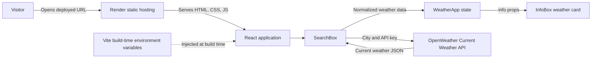
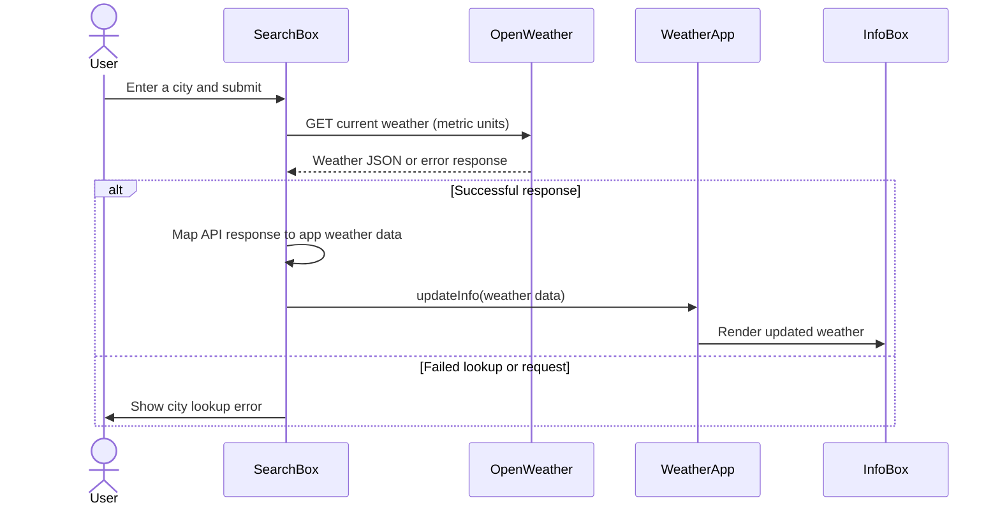

# ClimaCast — Live Weather Forecast

ClimaCast is a responsive, single-page weather app. Search for a city to see its current temperature, feels-like temperature, humidity, daily low/high, and a short weather description.

**Live app:** [climacast-vo1b.onrender.com](https://climacast-vo1b.onrender.com/)

## Features

- Search current weather by city.
- Display temperature, feels-like temperature, humidity, daily low, and daily high in metric units.
- Round the displayed low down and the high up to show an outward-rounded temperature range.
- Adapt the weather card’s image and icon to the returned weather data.
- Show an error message when a city lookup fails.
- Responsive layout for mobile and desktop.

## Built with

- [React](https://react.dev/) 19
- [Vite](https://vite.dev/) 8
- [Material UI](https://mui.com/) components and icons
- [OpenWeather Current Weather API](https://openweathermap.org/current)
- [Render Static Sites](https://render.com/docs/static-sites)

## System design

ClimaCast is a **static client-side application**. There is no application server or database: the browser requests weather data directly from OpenWeather, then React renders the result.



### Search and render workflow



### Source layout

```text
src/
├── App.jsx              # Root React component
├── App.css              # Page layout and responsive styles
├── WeatherApp.jsx       # Owns current weather state and page composition
├── SearchBox.jsx        # City form and OpenWeather request
├── SearchBox.css        # Responsive search form styles
├── InfoBox.jsx          # Weather card and display formatting
├── InfoBox.css          # Responsive card styles
├── index.css            # Global page styles
└── main.jsx             # React entry point
```

## Run locally

### Prerequisites

- Node.js compatible with the installed Vite version
- npm
- An OpenWeather API key

### Setup

1. Clone the repository and enter the project directory:

   ```bash
   git clone https://github.com/YOUR-USERNAME/YOUR-REPOSITORY.git
   cd YOUR-REPOSITORY
   ```

2. Install dependencies:

   ```bash
   npm install
   ```

3. Create a `.env` file in the project root (next to `package.json`):

   ```dotenv
   VITE_API_URL=https://api.openweathermap.org/data/2.5/weather
   VITE_API_KEY=your_openweather_api_key
   ```

   Replace the placeholder with your own key. Do not commit `.env`; it is excluded by `.gitignore`.

4. Start the development server:

   ```bash
   npm run dev
   ```

   Open the local URL printed by Vite in your browser.

## Environment variables

| Variable | Required | Purpose |
| --- | --- | --- |
| `VITE_API_URL` | Yes | OpenWeather Current Weather endpoint URL |
| `VITE_API_KEY` | Yes | OpenWeather API key |

Vite only exposes client-side environment variables with the `VITE_` prefix through `import.meta.env`. These values are substituted into the frontend bundle during the build.

> **Security:** `VITE_API_KEY` is not a secret after deployment. Anyone can inspect the browser bundle or network requests and retrieve it. Restrict the key in your OpenWeather account and monitor its use. For stronger protection, move weather requests behind a server-side proxy and keep the key in a server-only environment variable.

## Available scripts

| Command | Description |
| --- | --- |
| `npm run dev` | Start the Vite development server |
| `npm run build` | Create the production build in `dist/` |
| `npm run preview` | Preview the production build locally |
| `npm run lint` | Run ESLint |

Before deploying, run:

```bash
npm run lint
npm run build
```

## Deploy to Render

Deploy as a **Static Site** connected to the GitHub repository:

1. Push the project to GitHub. Confirm `.env` is not included in the commit.
2. In Render, select **New → Static Site** and connect the repository.
3. Configure the site:
   - **Root Directory:** the directory containing this `package.json` (leave blank if the repository root is this project).
   - **Build Command:** `npm install && npm run build`
   - **Publish Directory:** `dist`
4. In the Render service’s environment-variable settings, define `VITE_API_URL` and `VITE_API_KEY`.
5. Create the site and check the deployment logs for a successful build.

The `VITE_` variables are needed at **build time**. If you add or change them after a deployment, trigger a new deploy so Render rebuilds the frontend. Pushes to the connected branch can deploy automatically.

## Weather data flow

The app requests:

```text
GET {VITE_API_URL}?q={city}&appid={VITE_API_KEY}&units=metric
```

On success, the response is mapped into the fields used by the UI:

| App field | OpenWeather response |
| --- | --- |
| `city` | Search input |
| `temp` | `main.temp` |
| `tempMin` | `main.temp_min` |
| `tempMax` | `main.temp_max` |
| `feelsLike` | `main.feels_like` |
| `humidity` | `main.humidity` |
| `weather` | `weather[0].description` |

The weather card rounds the current and feels-like temperatures to the nearest degree. It uses `Math.floor` for the low and `Math.ceil` for the high.

## Limitations

- Weather requests are made from the browser, so the API key is visible to users.
- The initial Kolkata weather card is sample state; it is replaced after a successful city search.
- The card’s visual theme is selected using simple temperature and humidity thresholds; it is not a forecast.
- Weather photos are loaded from Unsplash and require an internet connection.

## License

No license has been specified for this project. Contact the project owner before reusing or redistributing it.
